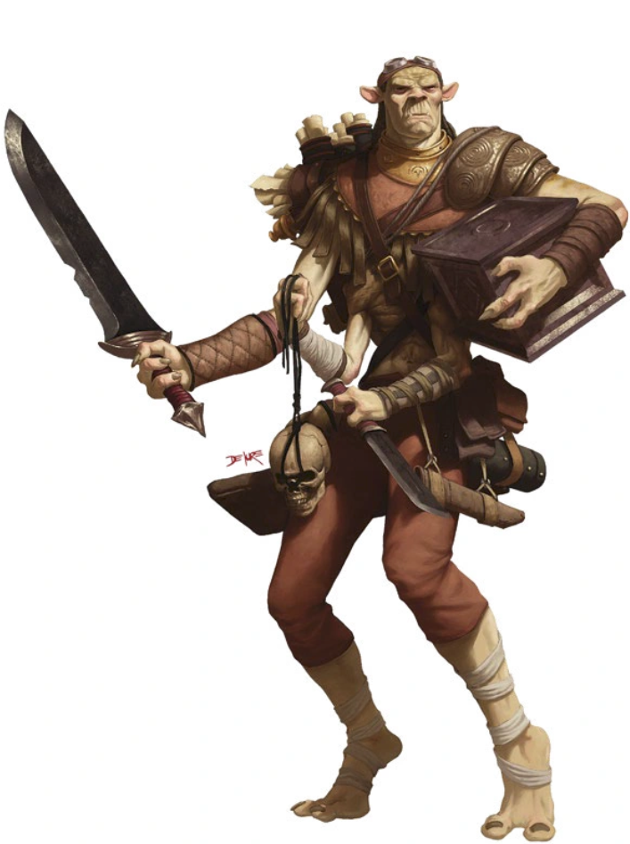

# 14 Oct 2026

**[Previously](2026-10-07.md):** After recuperating back in Elturel, we returned to the Court of the Lunar Knight on Ixona's planet of K'thar to rescue Galen. We managed to free him from the grasp of the Void Lord's tentacles, and Norgreath used Plant Shift get him back to Elturel, where he used Resurrection to restore him to life. Meanwhile on K'thar, the rest of the party battled the Void Lord. Realising we still could not beat him, Karthis cast Teleport and we all arrived instantaneously in the baronial castle. From there, Ixona used a coin, similar to Norgreath's, to bring us back to Norgreath's tower in Elturel, where we started to discuss our options....

---

As we talk about our plan in Norgreath's tower, suddenly we sense movement on the far side of the tower. Eight four-armed humanoids carrying large boxes materialise from a silvery path:

<figure markdown>
  { width="200" }
  <figcaption>Four-armed Creatures</figcaption>
</figure>

Karthis feels that these creatures arrived in the same way that we arrived, using a path token. He casts Fireball at them, doing a max of 36HP of fire damage. The creature in the middle, the one first affected by the attack, flips open his box a crack. It stops the whole fireball from expanding.

Lunghiss holds an action to cast Shadow Blade and attack, if Barrisso fails to parlay with them.

One of the enemy decides to target Gralok with his blade, doing 24HP of damage. The creature gets a second attack, doing another 37HP of damage. The creature seems confused by Gralok's resistance to its attack. His third attack does another 23HP of damage.

The next enemy (the one whose box somehow negated our spell) goes to Ixona and attacks her. She takes damage and fails a Con save, becoming stunned. The attacker uses his magical box and somehow sucks Ixona into it.

The third enemy moves to Karthis and attacks with his blade, which Karthis deflects with Arcane Deflection. His second attack misses, but the third attack does 34HP of damage and also stuns him until his next turn.

Barrisso attacks, doing 37HP of damage; his follow-up does 32HP. His offhand attack misses, but he gets lucky and does 34HP

Lunghiss's attack unfolds and he inflicts his 72HP of damage (plus 31HP if they move).

Galen casts Holy Aura on the party.

Another enemy seems to be slightly bigger and stronger than the rest. He attacks Galen and stuns him. His last attack targets the stunned Karthis but fails.

Lunghiss takes 33HP of damage but saves from being stunned. Lunghiss casts Shield to reflect the next attack. The third attack does 29HP and is stunned.

Another enemy moves to the stunned Karthis but his attempt to syphon Karthis into the magical box fails.

Yet another enemy tries the same move on the stunned Lunghiss but he resists.

Norgreath casts Shadow of Moil (which gives Lunghiss a beneficial dim light) then flies into the air.

The final enemy moves and opens its magical box, targetting Karthis. He is now inside one of those magical boxes.

Gralok attacks an opponent with his blazing cold greataxe, doing 26HP of damage.

---

Karthis realises he is in another place, blind and paralysed.

---

Lunghiss is stunned until the end of his turn.

A wounded enemy tries to attack Gralok, doing 16HP of damage but resists being stunned. Another attack does 27HP of damage.

The next four-armed attacker slashes at Lunghiss takes 27HP of damage. The second attack misses, while the third reduces him to 19HP and he's also stunned.

Another enemy moves around Gralok and tries to capture Galen in his magical box but fails. He then attempts to attack Gralok but misses.

Barrisso attacks a creature and manages to kill him. As he fails, we see that the box under his arm collapses in on itself. Fortunately, none of the party are in that box. Barrisso attacks an opponent in front of him but misses.

The enemy in front of Barrisso attacks him, doing 13HP of damage but he resists being stunned. His third critical attack does 41HP.

Suddenly, Ixona reappears from the box! *(Wisdom save)*

Galen is stunned until the end of his turn.

Lunghiss resists being absorbed by the powerful enemy and his box.

Barrisso is attacked; the first does 12HP of damage; the next attack does 36HP.

Another enemy attacks Lunghiss with his box, but the latter resists. He then attacks Barrisso but misses.

Another enemy tries to capture Lunghiss in his box, but misses. Frustrated, he attacks Lunghiss, who falls.

Norgreath casts Eldritch Blast (with Agonizing Blast) and Genie's Wrath Cold Damage, doing 15HP of damage. His follow-up does 7HP damage, while his final does 23HP of damage.

The enemy who seems to have Karthis in a box moves and attacks Gralok, doing 35HP.

Gralok attacks an enemy beside him, doing 28HP damage.

---

Karthis, inside the box, manages to free himself. He casts Last Rays of the Dying Sun - yet somehow, one of the enemy manages to suck the effects of the spell into his box.

Lunghiss fails a death save.

An enemy attacks Ixona with 37HP of damage; she is also stunned and is then recaptured in a magical box by one of the enemy.

Another enemy attacks Karthis but misses.

Another attacks Galen, injuring him but failing to stun him. He tries to attack a second, then third time but misses again.

Barrisso heals himself for 85HP. As a bonus action, he strikes an opponent in front of him, but misses. He casts Hunter's Mark on an enemy.

Galen casts Mass Heal, reviving Lunghiss and healing all of the party back up to full.

Barrisso is attacked; the last strike connects, doing 14HP.

Another attacks Norgreath, doing 37HP of damage. The attacker suffers 17HP necrotic damage from Norgreath's Shadow of Moil. He attacks again, but Norgreath avoids being stunned.

Another enemy attacks Norgreath, doing 29HP of damage. Another attack does 21HP of damage. A final does 18HP of damage. In return, Norgreath's Shadow of Moil does 29HP of damage. Norgreath uses a limited wish to cast Destructive Wave, doing 19HP thunder and 19HP necrotic damage. One enemy suffers damage, but another manages to counter the spell with his magic box.

An opponent attacks Karthis, who deflects the attack with Arcane Deflection. A follow-up attack does 25HP.

Gralok attacks, doing 36HP of damage to the enemy beside him.

---

Karthis can only cast cantrips this round, so he casts Fire Bolt but misses.

Lunghiss sneak attacks the enemy to his north-east with his Shadow Blade (using Savage Attacker), doing 70HP of damage (plus 9HP thunder if they move).

The enemy with Ixona in his box attacks Karthis, doing 31HP of damage. A second attack misses, while the third does 27HP of damage and stuns him.

Another opponent tries to use his magic box on Karthis, but fails.

ANother enemy misses Gralok.

Barrisso attacks the enemy his Hunter's Mark is on. He falls. He then attacks another opponent, and with a critical, kills him. Suddenly, only five opponents are left.

Galen casts Power Word Fortify.

A creature attacks Norgreath but misses.

Norgreath attacks the enemy he considers most wounded with Eldritch Blast with Agonizing Blast and Genie's Wrath, doing 50HP of damage.

An enemy uses the trapping power of his magical box on Karthis but misses.

Gralok is wounded, and attacks in response, wounding the creature.

---

Karthis casts Fire Bolt at the opponent to his west, but misses.

Lunghiss sneak attacks with his Shadow Blade (using Savage Attacker), doing 70HP of damage to the enemy next to him.

Karthis suffers 28HP from his attacker.

Another opponent lashes out at Galen, doing 50HP of damage and also stunning him.

Barrisso attacks the opponent to his north-west; using Divine Smite, doing 55HP in total.

Galen has been stunned, but is freed at the end of his round.

The opponent just attacked by Barrisso attacks Norgreath, doing 21HP of damage and stunning him, but suffering 11HP from his Shadow of Moil. His second attack attempts to capture him in his magic box but fails...
