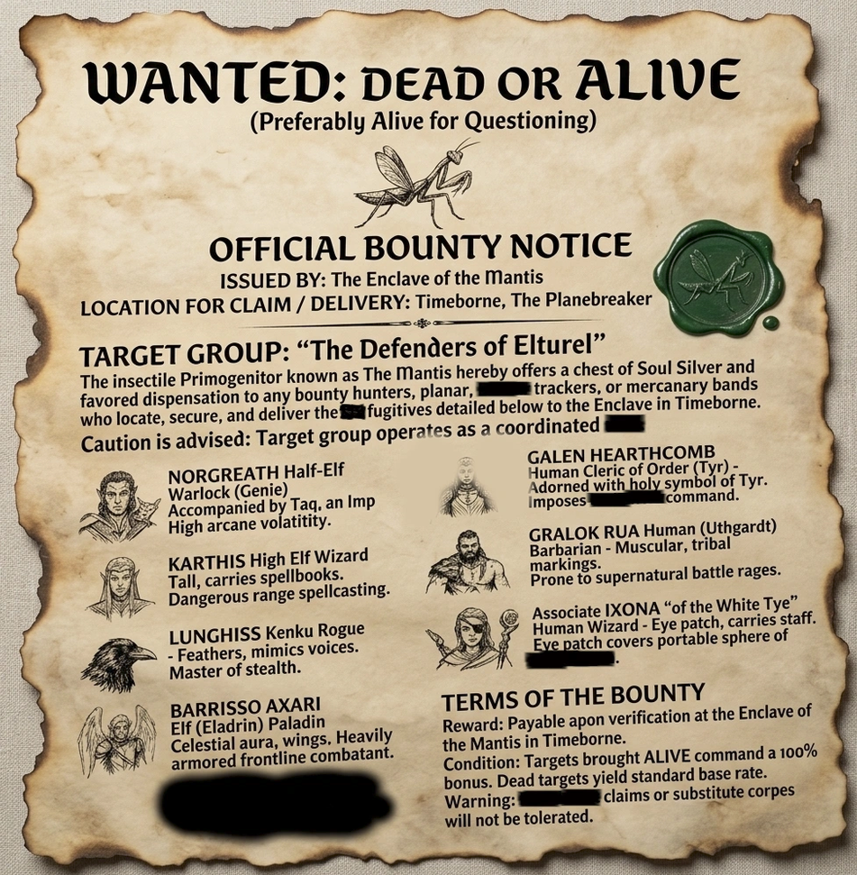
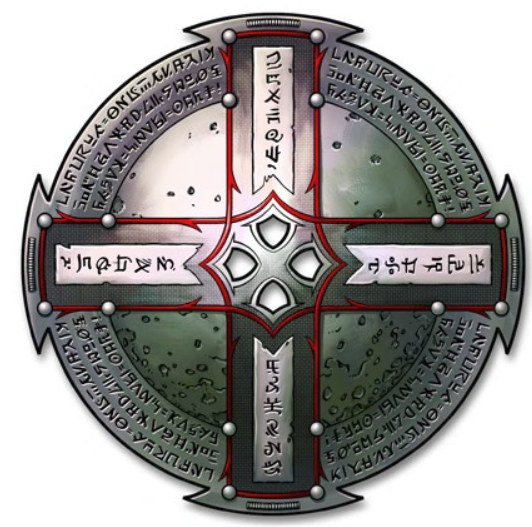

# 21 Oct 2026

**[Previously](2026-10-14.md):** We fled our fight with the Void Lord and recuperated back in Elturel. We returned to the Court of the Lunar Knight and rescued Galen using Plane Shift get him back to Elturel, where he used Resurrection to restore him to life. The rest of the party escaped the Void Lord using Teleport. As we discussed our plans in Norgreath's tower, a group of four-armed humanoids carrying weapons and ornate boxes appeared via a silvery path such as that created by Norgreath's own path token. They turned out to be formidable opponents; their blows can stun us, at which point they used some kind of music to absorb us into their boxes...

---

The four-armed enemy in the middle of the fight attacks Karthis; his third blow knocks him to the ground, gravely wounded.

Gralok attacks the enemy beside Karthis, doing 15HP of damage.

Karthis fails his death save.

Lunghiss moves in and sneak attacks the southern-most wounded enemy using his Shadow Blade; his 63HP of damage kills it.

An opponent attacks Gralok, doing 20HP of damage; Gralok uses Inspiration to avoid being stunned. The second attack does 14HP of damage and Gralok is now stunned. The creature then tries to capture Gralok in its magical box, but fortunately fails.

The next opponent also tries to capture Gralok in its box and succeeds. It then attacks Barrisso, doing 20HP of damage.

Barrisso retaliates with his Fool's Shortsword and adds damage using Divine Smite, doing 30HP of damage. His next attack does 15, while an offhand attack misses.

Galen is stunned at the moment but rouses at the end of his round.

Norgreath targets the most wounded opponent and attacks using Eldritch Blast with Agonizing Blast and Genie's Wrath - he kills the opponent. He then targets the western-most opponents and does a critical attack, doing 17HP of damage. His next attack does 16HP, while the final does 8HP.

Gralok succeeds in a Wisdom saving throw and reappears from the box where he was captured.

---

Karthis succeeds his death saving throw.

Lunghiss sneak attacks the most wounded enemy again using his Shadow Blade and Savage Attacker; 79HP of damage brings it down. One opponent remains.

That opponent attacks Gralok, doing 29HP of damage, then 21HP of damage. Fortunately Gralok is not stunned.

Barrisso attacks the last enemy, doing 14HP. He uses Divine Smite to add another 30HP of damage. He attacks with his Fool's Shortsword again, doing 18HP. His offhand attack with his scimitar does 12HP of damage.

Galen casts Mass Cure Wounds, giving everyone in the party 31HP of health back. Karthis is now revived, albeit exhausted and prone.

Norgreath attacks using Eldritch Blast with Agonizing Blast and Genie's Wrath, doing a total of 63HP damage.

Gralok smashes his blazing cold greataxe into the enemy - and it falls. Its box collapses in on itself, and Ixona pops out of the remains.

---

When we search the body of what seems to be the leader, we find a new path token (unlike in appearance to the ones which Norgreath and Ixona possess), 274 platinum pieces - and a bounty poster for our party! They seem to have been sent by the Mantis.

<figure markdown>
  
  <figcaption>Bounty Poster</figcaption>
</figure>

<figure markdown>
  
  <figcaption>New Path Token</figcaption>
</figure>

From their bodies, Barrisso gets a sense of fading magic from them, but none of their items actually seem magical.

**Everyone goes up to Level 18.**

---

We have a number of options. We could go to the Mantis and parlay, to stop these attacks on us. Or we could meet with Manizer to ask her advice. Or we could go to Candlekeep and do research. Or we could return to K'thar, and finish off the Void Lord.

We decided to check that the Tyrant of War is still on the Positive Plane where we left it. We activate the key, and portal appears before us. And a glance through shows it is still where we left it. Suddenly our view shifts to the archway next to the ship itself. We wait until the portal dissipates, until Norgreath dismantles the key.

In order to hide the key elements and keep them safe from the Mantis, Norgreath casts Demiplane and places all but one piece into the new plane.

We decide the first we should talk to Manizer; Karthis casts Sending to transmit a message to her saying we would like to meet.

Lunghiss uses the day we have to wait for Manizer to check poisons in the six finger bones we acquired back in 2025-02-19/:

- **Burnt Othur Fumes (Inhaled):** A creature subjected to this poison must succeed on a DC 13 Constitution saving throw or take 10 (3d6) poison damage, and must repeat the saving throw at the start of each of its turns. On each successive failed save, the character takes 3 (1d6) poison damage. After three successful saves, the poison ends. Inhaled. These poisons are powders or gases that take effect when inhaled. Blowing the powder or releasing the gas subjects creatures in a 5-foot cube to its effect. The resulting cloud dissipates immediately afterward. Holding one's breath is ineffective against inhaled poisons, as they affect nasal membranes, tear ducts, and other parts of the body.
- **Carrion Crawler Mucus (Contact):** This poison must be harvested from a dead or incapacitated crawler. A creature subjected to this poison must succeed on a DC 13 Constitution saving throw or be poisoned for 1 minute. The poisoned creature is paralysed. The creature can repeat the saving throw at the end of each of its turns, ending the effect on itself on a success. **Contact:** Contact poison can be smeared on an object and remains potent until it is touched or washed off. A creature that touches contact poison with exposed skin suffers its effects.
- **Essence of Ether (Inhaled):** A creature subjected to this poison must succeed on a DC 15 Constitution saving throw or become poisoned for 8 hours. The poisoned creature is unconscious. The creature wakes up if it takes damage or if another creature takes an action to shake it awake. **Inhaled.** These poisons are powders or gases that take effect when inhaled. Blowing the powder or releasing the gas subjects creatures in a 5-foot cube to its effect. The resulting cloud dissipates immediately afterward. Holding one's breath is ineffective against inhaled poisons, as they affect nasal membranes, tear ducts, and other parts of the body.
- **Malice (Inhaled):** A creature subjected to this poison must succeed on a DC 15 Constitution saving throw or become poisoned for 1 hour. The poisoned creature is blinded. **Inhaled.** These poisons are powders or gases that take effect when inhaled. Blowing the powder or releasing the gas subjects creatures in a 5-foot cube to its effect. The resulting cloud dissipates immediately afterward. Holding one's breath is ineffective against inhaled poisons, as they affect nasal membranes, tear ducts, and other parts of the body.
- **Oil of Taggit (Contact):** A creature subjected to this poison must succeed on a DC 13 Constitution saving throw or become poisoned for 24 hours. The poisoned creature is unconscious. The creature wakes up if it takes damage. **Contact:** Contact poison can be smeared on an object and remains potent until it is touched or washed off. A creature that touches contact poison with exposed skin suffers its effects.
- **Torper (Ingested):** A creature subjected to this poison must succeed on a DC 15 Constitution saving throw or become poisoned for 4d6 hours. The poisoned creature is incapacitated. **Ingested:** A creature must swallow an entire dose of ingested poison to suffer its effects. The dose can be delivered in food or a liquid. You may decide that a partial dose has a reduced effect, such as allowing advantage on the saving throw or dealing only half damage on a failed save.

Lunghiss also uses his poisoner's kit to create nine coatings of contact poison, which each will inflict an instant 2D6 of poison damage.

Norgreath takes some time to check on some potions we picked during our travels. We have:

- Invulnerability
- Frost Giant Strength (2)
- Elixir of Health
- Mind Control - Humanoid
- Aqueous Form
- Invisibility (2)
- Mind Reading

---

The day after the Sending spell was cast, [Manizer has still not appeared...](2026-10-28.md)
