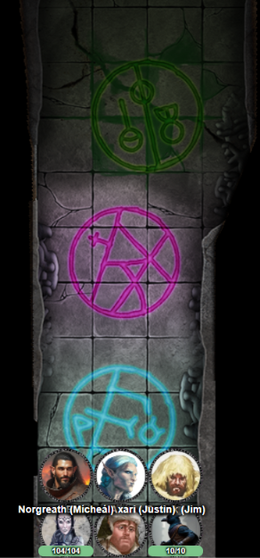
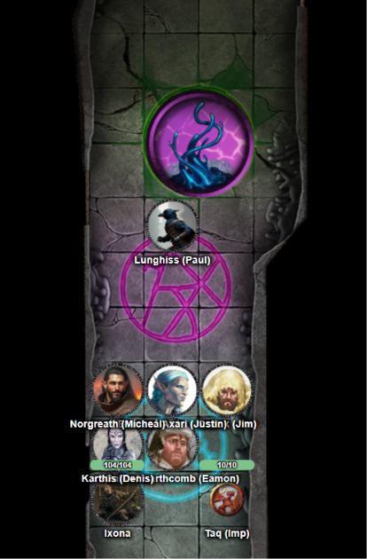

# 28 Oct 2026

**[Previously](2026-10-21.md):** After fleeing the Void Lord, while recuperating in Norgreath's tower, we were attacked by what turned out to be bounty hunters sent by the Mantis. She obviously feels slighted that we have not given her access to the Tyrant of War. We checked that the vehicle is still where we left it on the Positive Plane. Norgreath then dismantled its key and placed all but one of the segments into a demiplane that he created. We decided we should seek advice from our recruiter Manizer. But despite Karthis having communicated with her using Sending, we have not yet heard a response...

---

Norgreath uses Speak with Dead to interrogate the now-dead bounty hunters. On the first, he asks the following questions:

"How did you find us in Elturel?"

"We managed to Scry Ixona's location."

"What would have happened if you had managed to capture us in your magical boxes?"

"We would have brought you to Timeborne to face the Mantis."

"Where are you from?"

"We are from Nambu, which is lost to the Void."

"How many parties of bounty hunters are looking for us?"

"Oh, I only know about us."

"By what means did you Scry Ixona across the planes?"

"I didn't."

Next body:

"How did the entity who found Ixona Scry her across the planes?"

"I don't know."

"Why was there a bounty put on us?"

"We don't question the bounty, we just want to know what we earn."

"Where is your base?"

"Our base of operations is in Timeborne."

We decide we don't need to ask any more questions.

---

Norgreath uses his path token to summon the familiar silvery path. This leads us away from Elturel and as we walk, we see far below us a hypnotic landscape in flux. We see constant but slow mudslides from high cliffs; it's surreal as we cannot work out where this endless mud is coming from or indeed going. There is no sign of sentient life, just primordial activity. We pass on.

We next find ourselves in darkness with brilliant roads picked out in bright lights, spanning a huge continent of cities beneath us. We continue on the path and that vision fades away. We eventually see a less pleasant scene of a stony basalt fortress on a lifeless plane. The fortress is bedecked with half-burnt humanoid bodies. We also see and smell piles of ash perhaps from previous bodies. We continue onward.

The path itself leads us to Timeborne. When we previously came here, we were dumped in the Sea of Uncertainty. This time, we find ourselves in a square inside the city walls. Ahead of us we see the enclave of the Mantis we previously visited. We head towards this enclave.

We see bounty posters pinned up on the walls; we figure this is where our bounty hunters discovered us. We head inside in order to have an audience with the Mantis. We find ourselves in a dimly-lit wide chamber with a brazier. On a dais, the many-limbed creature we know as the Mantis is reclining on a petal-like throne, flanked by a ten-foot-tall four-armed demonic creature and humanoid winged creature with silvery skin.

"Why have you come to the court of the Mantis?"

"We seek clarification and perhaps an intercession. There was a bounty placed on us - we would like to understand why."

One of the Mantis' minions says:

"You were asked to do something. You did not do it."

"There was no time limit on this task. But the Mantis would be happy to accept the key. There is no longer need for the bounty. But what do you intend to do now?"

"For the moment, we have no direct plan."

The glabrezu says "Those without a plan oft fail."

The diva speaks "Surely your experience to date shows what might fail."

In our heads, we hear what seems to be the Mantis shouts about the loss of Ixona's world. We need to find where the Heralds of the Comet are active so that the Tyrant of War does not have to be used. We are advised to consult a sage.

As we are leaving the chamber, in our path materialises a chest. "This is your bounty." Inside are 1,000 pieces of soul silver.

---

We visit the Library of Worlds, which we have visited before: a five-story building with a dome hovering over it. The main entrance is flanked by sculptures of humanoids reading from tomes. We see a harried-looking woman with long white hair, carting around a dozen books. As we enter, she confronts us and we get into a fight about X.

Eventually she offers us a cup of tea and leads us through the stacks of books. We end up in a living room with an open fire and couches. For the first time, we see other librarians around, who offer help to this lady, Lindel. She asks for tea and refreshments for us.

We ask her about the Heralds of the Comet, and tell us what happened on K'Thar. It seems that if we fail, all worlds in the Multiverse could be lost.

"Or we stop this place?"

"This place?"

"The Planebreaker."

"We bring the Tyrant of War against the Planebreaker?"

"It's not great, but might be the only way. The power that path tokens use is the path of the Planebreaker. But that is a series of holes in the Multiverse. Through those holes, something is getting in."

"Can these rifts we closed?"

"We're not sure. Is the ultimate solution to destroy the Planebreaker? Maybe."

"I don't know if the Mantis wants the Tyrant of War in order so it can't be used to destroy the Planebreaker. Perhaps she is keeping her options open. The Planebreaker is a moat of survival from a prior Cosmos. A curse called the Annihilation would destroy this prior Cosmos and any potential rebirth. The Planebreaker is a lifeboat from a dying universe. Other entities from that earlier Cosmos survive, including the Mantis. The Far Realm is the continuation of the Annihilation.

"The Mantis can create soul silver. In fact, it is part of her essence, her life-force. She can produce a number of pieces a day, and could completely deplete herself. It has magical qualities: each coin has healing qualities, while a chest of it (1,000 pieces) enables you to call upon the Mantis in the form of a wish."

"I can tell you of a place you might encounter the Heralds of the Comet. A place called the Leystone of the Indigo Star, on a plane called Lagriss."

---

We step back onto Norgreath's path and find ourselves looking down at a landscape of flame and ash. We continue on and find ourselves over an ocean world with seas so clear we can see the drowned world beneath the water, including a fortress of coral, fish and other aquatic creatures. We also see aquatic humanoids with tridents guarding the fortress.

We continue unless we see a dusty plain which the path leads us down towards. Some of the sky looks like it has been severed, with patches of Void-like nothingness. The path leads directly to a tunnel which leads to a complex under the plane.

In the passageway are three patterns of scintillating colours. One side of the wall looks like it has melted at some point, with trapped humanoids reaching out from it

<figure markdown>
  
  <figcaption>Glyphs</figcaption>
</figure>

Barrisso detects magic from two of the glyphs, but from the third there is no magical aura.

Lunghiss *(Perception/Arcana check)* is sure the first glyph is a Glyph of Warding, which would emanate cold energy. The second glyph seems to be a glyph of warding too, but beyond his knowledge.

Karthis casts Dispel Magic on the first glyph and its magic fades.

He casts a second Dispel Magic, and dispels the second glyph.

Lunghiss checks the third, non-magical, glyph. Suddenly a Void creature appears on the glyph, formed from the liquid in the circle:

<figure markdown>
  
  <figcaption>Glyph Void Creature</figcaption>
</figure>

Karthis casts Chill Touch on the ooze, damaging it.

Gralok rages and uses Call the Hunt on Lunghiss, Barrisso, Galen and Norgreath. He attacks the Void creature with his axe, doing 25HP of damage.

Ixona casts Fire Bolt at it, doing 20HP of damage.

Norgreath casts Eldritch Blast with Agonizing Blast and Genie's Wrath, doing 31HP of damage.

The creature itself then attacks Lunghiss twice, who uses Shield to protect himself. It then attacks Gralok twice but also misses.

Barrisso attacks it with his Fool's Shortsword, doing 19HP plus 13HP with Divine Smite. His second attack does 19HP of damage. His offhand critical attack does 28HP, finishing the creature off, which oozes back into the ground.

---

We check out the first door on the left-hand side of the passage. We find ourselves in a hallway running east-west, with another red glyph at the far end in a small room. This room is covered in parchment and also contains a bed. A statue of a stern tiefling is on the northern side of the room. There is a faint hint of Abjuration magic from the bedding.

Lunghiss checks for traps but does not find anything. Barrisso checks the pieces of parchment. They seem to have undecipherable notes. Karthis checks them and notices a repeated name, Askalan. The notes suggest he found something he calls a Falling Star, which he took to his own home where he spend years studying it. A while ago, Askalan found this place he calls the Leystone of Vale Turog. He used this fallen star in these chambers and the place came to life.

As Karthis continues reading, the madness of Askalan's writing takes a toll on him, and he takes 10HP of psychic damage.

Meanwhile, Barrisso finds a spellbook under the bed, which he gives to Karthis. The spellbook contains the spells Alarm, Arcane Lock, Banishment, Chill Touch, Dispel Magic, Firebolt, Glyph Of Warding, Mage Armor, Mage Hand, Magic Circle, Mending, Nondetection, Planar Binding, Protection From Energy, Shield, and Stoneskin.

Lunghiss continues from where Karthis left off. Askalan is describing an engineering problem, where the power cell in which the Fallen Star rests sends energy into brass cauldrons, which mixes it with blue liquid which causes a black obelisk to spin, which draws ley-line energy, which charges powerful artefacts. There are ways to slow down the rotating obelisk. Portions of the chambers were damaged hundreds of years ago when the energy was left on for too long. Askalan manually places spheres into the cauldron to avoid more destruction. Amongst the notes are two words in the margin in Infernal. Barrisso recognises them: "Ignite" and "Infuse". That is all we can glean from the notes.

We return back down the corridor and check the next door up. There at the end of a corridor we find a chamber with a violet glow. A pair of vented iron blocks, ten feet square, are humming and shaking violently. Glass tubes filled with blue liquids link the blocks and the wall....
