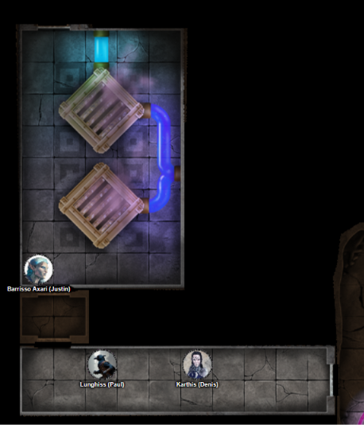
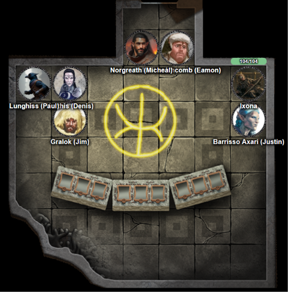
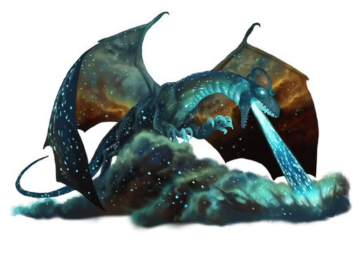

# 4 Nov 2026

**[Previously](2026-10-28.md):** Using Speak with Dead, Norgreath interrogated the bounty hunter corpses: their plan had been to bring us back to face the Mantis. We decided the best course of action was to confront her directly. Norgreath used his path coin to bring us to Timeborne, where an angry Mantis indicates she is unhappy we haven't brought her the Tyrant of War and that our inaction is causing worlds (such as Ixona's) to fall to the Void. She advised us to consult a sage and find where the Heralds of the Comet are active, if we do not want the Tyrant of War to be used. We visited the Library of Worlds and spoke to Lindel, who reminded us of our fight with the Golden Skulls agent Kreeger who had found a way to predict the location of the Tyrant of War. She also offered another solution: destroy the Planebreaker. The power that path tokens use is the path of the Planebreaker, which creates a series of holes in the Multiverse. Through those holes, *something* is getting in. Perhaps the Mantis wants the Tyrant of War so that it *cannot* be used against the Planebreaker. She then told us where we might find the Heralds of the Comet: a place called the Leystone of the Indigo Star, on a plane called Lagriss. We travelled there using the path token and beyond a passageway guarded by defensive glyphs, found a room with scattered parchment, and noticed a repeated name, Askalan. The notes suggest he found something he calls a Falling Star, which he spent years studying. Askalan found this place he calls the Leystone of Vale Turog, and used this fallen star in these chambers to bring the place to life. The power cell in which the Fallen Star rests sends energy into brass cauldrons, which mixes it with blue liquid which causes a black obelisk to spin, which draws ley-line energy, which charges powerful artefacts. There are ways to slow down the rotating obelisk. Portions of the chambers were damaged hundreds of years ago when the energy was left on for too long. Askalan manually places spheres into the cauldron to avoid more destruction. Amongst the notes are two words in the margin in Infernal. Barrisso recognises them: "Ignite" and "Infuse"...

---

To recap: there are a pair of vented iron blocks in the room, about 10 feet cubed. They are shaking and humming violently. They exude twisted glass and metal tubes filled with liquid: to our east is a deep blue liquid that goes into the eastern wall. To our north, a lighter blue liquid travels through a tube to the north wall. Next to that is a black iron door with the embossed face of a tiefling on it. There are tiled patterns on the floor.

<figure markdown>
  
  <figcaption>Iron Cubes</figcaption>
</figure>

Lunghiss *(Perception check)* sees that the dark blue liquid is feeding into both blocks and the light blue liquid is feeding out of the block.

Suddenly, something appears above the northern block. It looks like an energy mote of some type, emitting tendrils of lightning. One shoots at Lunghiss and enters his face. It does not appear to do any damage. This seems to be rather strange. Lunghiss *(Arcana check)* has not seen or heard of such a thing before.

Lunghiss checks the door for traps, and fails miserably. He then he checks the embossed face on the door. It does not appear that it would move. However, with his close examination, he feels that it is emanating necrotic energy.

Barrisso, who is resistant to necrotic damage, tries to push or pull the door to open it. Luckily, he resists some damage and only takes 11HP of necrotic damage. We decided to leave the door in this chamber and explore elsewhere. We leave south, then head east.

As the party move, they notice Lunghiss' movements are jerky and erratic. Barrisso *(Medicine check)* cannot determine what is wrong. Lunghiss assures the party he is fine, in a jerky speech. Galen *(Medicine check)*. Barrisso's True Sight and Detect Magic do not help either.

Suddenly, Lunghiss' arm shoots out and a cloud appears on the ceiling of the corridor. Bolts of lightning streak out from it towards us. However, most of the party escape the worst damage. Lunghiss looks surprised, but seemingly has no ability to control what he does.

Gralok doesn't do anything, while Norgreath turns invisible then moves.

Ixona casts Dispel Magic and the cloud disappears.

Galen casts Greater Restoration on Lunghiss. This seems to have no effect.

Barrisso uses Cleansing Touch on Lunghiss, but nothing seems to change.

Lunghiss twitches and mutters and suddenly casts a Lightning Bolt down the corridor, doing a max of 30HP of lightning damage.

Gralok attacks Lunghiss non-lethally with his great axe in an attempt to knock him out. As he does, a strange electrical bolt appears where Lunghiss is, showering sparks of lightning. Lunghiss looks confused and shakes his feathers.

Norgreath casts Eldritch Blast with Agonizing Blast and Genie's Wrath (cold damage). He does a total of 58HP of damage. He feels that it did not take the full brunt of his attack.

Ixona attacks the mote using Melf's Minute Meteors, but seems to do little damage.

Galen casts Toll the Dead on the entity but fails.

Barrisso also tries Toll the Dead, doing 35HP of damage, killing it.

Galen casts Prayer of Healing to restore 28HP to everyone who needs it, then casts Cure Wounds to restore Ixona to full health.

---

We continue on, moving east, then north, then east again, then south. We find ourselves in a small chamber containing a yellow glyph and three large stone blocks in a half-circle facing the door. Each block has a brass-lined basin of metallic liquid. The leftmost block is badly cracked and the liquid in it is much darker than that of the other two blocks.

<figure markdown>
  
  <figcaption>Basin Blocks</figcaption>
</figure>

Barrisso examines the blocks. He perceives raised marks near the basic but they do not appear to be a script, just geometric patterns.

All of the block exude Divination magic.

We move out of the corridor and to our north, see a creature we haven't seen before.

<figure markdown>
  
  <figcaption>Star Dragon</figcaption>
</figure>
hiss

It speaks in Common: "Begone from this place before my mother notices you."

Galen casts  Channel Divinity: Order's Demand on the creature then presents his holy symbol.

"We are on a critical mission - let us pass."

We hear a strange noise coming from the creature. It's laughter.

Karthis asks where its mother is.

"My mother lies beyond."

"Could you be more specific?"

"I don't need to be because you will not get there."

Karthis casts Fireball at it and the creature appears to take damage, screeching in pain.

Lunghiss casts Shadow Blade and sneak attacks the creature, doing 76HP of damage, plus 21HP if it moves. He then retreats behind the party.

Norgreath casts Eldritch Blast with Agonizing Blast and Genie's Wrath (cold damage), doing 38HP of damage - the creature dies. We wonder if the mother somehow knows.

---

Around the corner rushes a similar creature, but it seems to be very angry. It breaths on us, doing both fire (max 23HP of fire damage) and radiant damage (max 28HP of radiant damage).

It shouts "Mother! They have killed Ktharsh!"

Barrisso attacks it with his Fool's Shortsword and uses Divine Smite to do a total of 52HP of damage.

Ixona casts Melf's Minute Meteors at the creature, injuring it but not as much as she hoped.

Galen casts Toll the Dead, doing 28HP of necrotic damage.

Lunghiss casts Shadow Blade and sneak attacks the creature, doing 83HP of damage, killing it.

To our left there is a door. Norgreath hears a very loud noise behind it, almost like a storm or a powerful wind is whipping around in the chamber beyond. Norgreath turns invisible.

Gralok moves to beside Norgreath and holds an action to attack anything that comes through the door.

Barrisso sees a huge tentacled monster coming down the corridor from the north. Above the noise of the storm coming from the west is a mental screech which is terrifying. 

Barrisso casts Sacred Flame at the tentacled creature, damaging it.

Ixona moves down the corridor away from the oncoming enemies.

Lunghiss moves around the corner and hides.

Galen casts Bless on the party apart.