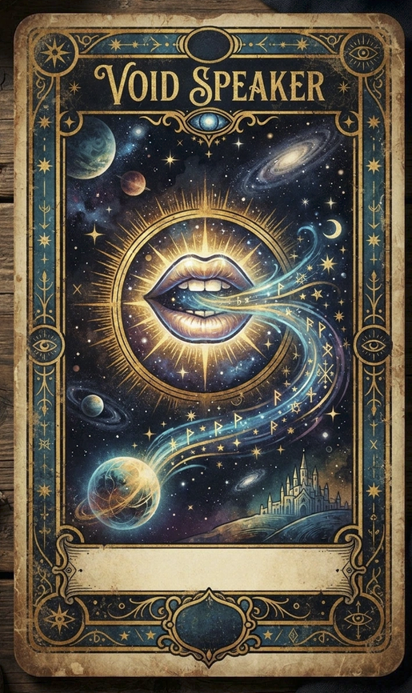

# 25 Nov 2026

**[Previously](2026-11-11.md):** We confirmed that the black sphere in the canister was a Sphere of Annihilation and carried it towards the double doors using Mage Hand. After healing and preparing ourselves, we entered a vast chamber dominated by a rapidly spinning obelisk, with a shadowy creature circling above it. Beneath it was a raised dais with protective glyphs and two blue tubes connecting it to the walls. Karthis triggered a glyph while examining it, and Barrisso suffered a similar attack when reaching across the dais. We discovered that anything touching the spinning obelisk was quickly shredded, as happened to Barrisso's rope. Norgreath destroyed part of one tube with Disintegrate, triggering an arcane lightning discharge throughout the chamber. Gralok smashed the second tube, triggering another. Karthis and Ixona attacked the shadowy creature with critical Fire Bolts, revealing it to be a massive dragon formed from the night sky, with stars for eyes, a blazing heart and horns connected to a Sphere of Annihilation. The dragon savaged Barrisso with its claws, bite and tail, while Norgreath pushed it back with Eldritch Blasts. Gralok attacked the obelisk with his maul, but was repeatedly hurled across the chamber and injured by its lightning and glyphs. The dragon knocked Barrisso unconscious, but Galen's Heal restored 70HP, allowing him to hover safely on his angelic wings. Ixona continued attacking before the dragon unleashed Stellar Breath, inflicting fire and radiant damage across the chamber and knocking her down. Galen used Holy Aura to protect the party, while Gralok shattered the obelisk with his Ring of the Ram, sending shrapnel across the room. With most of the party badly injured and Ixona close to death, Galen cast Mass Heal to facilitate our escape. Barrisso failed to banish the dragon, and Ixona's final Fire Bolt missed. With the dragon preparing another breath attack, Norgreath planeshifted us back to Elturel...

---

Back in Norgreath's chamber, we find a card on his table:

<figure markdown>
  
  <figcaption>Void Speaker Card</figcaption>
</figure>

Karthis feels that the card is cold in his hand. Norgreath *(Arcana check)* feels that it is like a card from the Deck of Many Things, but not of the same styling. Having picked it up, he feels he could benefit by concentrating on it. Before that, we take a long rest; first, Galen casts Greater Restoration on Ixona.

---

The next morning, we awaken fully recovered. Norgreath takes up the card again and concentrates. He gets an impression that the card is linked to a similar entity that someone else possesses; something like a Sending spell.

Norgreath speaks: "Hello, you left this card?"

A familiar voice says: "Oh, you're back. Can I come through?" It's Manizer.

"Yes, you're welcome."

While we wait for Manizer, we order some food, and a lavish spread is laid in front of us. While we chow down, a familiar presence appears in the chamber from a misty path. 

"Welcome Manizer, can I interest you in some food?"

"Yes! Bread and cheese. Of course."

She takes note of the party, including the presence of Ixona and the lack of Taq, and helps herself to some food.

"Fill me in. I left my greeting card so I can find out what is going on with you."

We tell her what happened with the Mantis, and tell her where we have put the Tyrant of War, the events on K'Thar, and our attempt to get rid of the Heralds of the Comet. 

She has questions.

"You put the Tyrant on the Positive Material Plane? And then were persuaded by the Mantis to give her a segment of the Key, once she put a bounty on you? So what do you plan to do, now you have been thwarted?"

"Perhaps we can try again, but this time with perhaps more aid from the likes of yourself."

"Nice try. As a Tyrant Tamer, my aim is to prevent the Tyrant of War being used for more destruction. You have uncovered a nefarious group, the Heralds, trying to destroy the Multiverse using Void connections. There seems to be some link between them and the Planebreaker."

"Who can advise us?"

"Perhaps sages, who know of the Heralds, or can point you to location where they have been scheming, so you can learn their plans. However, you've tried to do that twice. These Void beings seem difficult to defeat. She ask her about other primogenitors of the multiverse: she mentions the Lady of Pain."

We decide we need to go back to Timeborne and to the Mantis.

---

Using Norgreath's path token, we arrive back on Timeborne. On our way there, we travelled thru an icy world of caverns and tunnels through which our path plunged into a world where the path soars above a many-levelled fortress of fire, like a fountain, on an obsidian plane. Devils cavorting in the flames cocked their snoots at Karthis. Beyond that realm was a vast tumbling skull which contained a city of tiny creatures that seemed to be mining what is left of the brain. Finally, our journey ended at a wide cobbled area in Timeborne. 

We notice a large circular pattern of magic symbols etched into the cobbles of the landing area. We head for the where we know the Mantis to be. We reach the flower-like dais again, on which the Mantis holds court. On her left is a ten-foot-tall four-armed demonic creature, a glabrezu; on a left an angelic creature with silvery skin. We tell them what has happened since we last saw her, including our unsuccessful combats.

The glabrezu speaks. "What do we care about this?"

"Do you wish to see the End of Worlds?"

The other creature says "The End of the Worlds is part of the natural cycle?"

"Not the accelerated version."

"Is there such an acceleration?"

"As you know we are investigating the Herald of the Comet and how they are allowing Void creatures into this plane. Can you help us?"

"How?"

"We have tried dealing with these incursions. We need help."

"Your efforts on these worlds are greatly appreciated by the Mantis..."

"...But we do not know what aid we can give you what would make you successful."

"Would information help?"

"What would you like to know?"

"Do they have any weaknesses?"

"When you say 'they', who do you mean?"

We explain the dragon-like creature we met. 

"It does sound like you are describing a Void dragon."

"Are they running amok a good thing?"

"These things are never as simple as a binary choice."

Simian (the angelic deva) steps down the from dais and approaches us.

"The Mantis wants you to know the Heralds of the Comet believe that creation is flawed, is not an accident, and that suffering and pain are evidence of this. The destruction of all worlds is imminent and people should prepare for it by renouncing wealth, possessions, relationships and gods. After the destruction of the multiverse, a new creation will take its place and the Elect will enjoy this paradise. The Planebreaker, a comet, is a signal of this. They often use variations of a Deck of Many Things to divine this future. However, these heralds are only tools. Their cult was created to allow these Void creatures into our worlds. When they do so, those Worlds become Void worlds by mutating the worlds and their natural laws. One of the things they try to do is remove magic from the worlds. We were not convinces that the heralds posed a threat to the multiverse. But what you say is that your recent experience has been similar and connected."

The glabrezu joins the deva and says:

"The other thing can also be true: we may be part of our own destruction. This Planebreaker may be the cause of the Multiverse's destruction. But maybe that is the way of things. What can we do?"

"We should deny them the route thru the multiverse."

"How?"

"Figure out their path and close it."

The deva says:

"How do you discover their path?

"Finds worlds they are infiltrating the cut them off before their plans mature."

"But you are but seven."

"Could we recruit champions to our cause?"

"You suggest the Mantis place bounties?"

"That is an option."

"The Mantis is willing to do such a thing but would need specific instruction."

"We may need to do some research."

"My lady suggests you visit the archivist. In the meantime, my Lady's agents will start investigations. We thank you for your concerns, and we will keep channels open."
